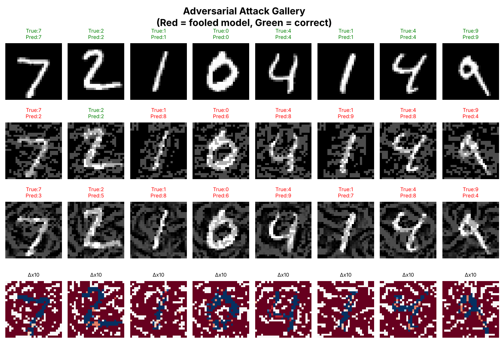
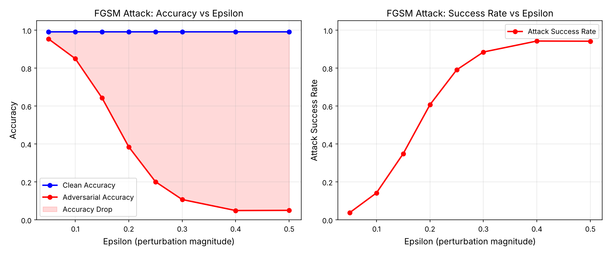
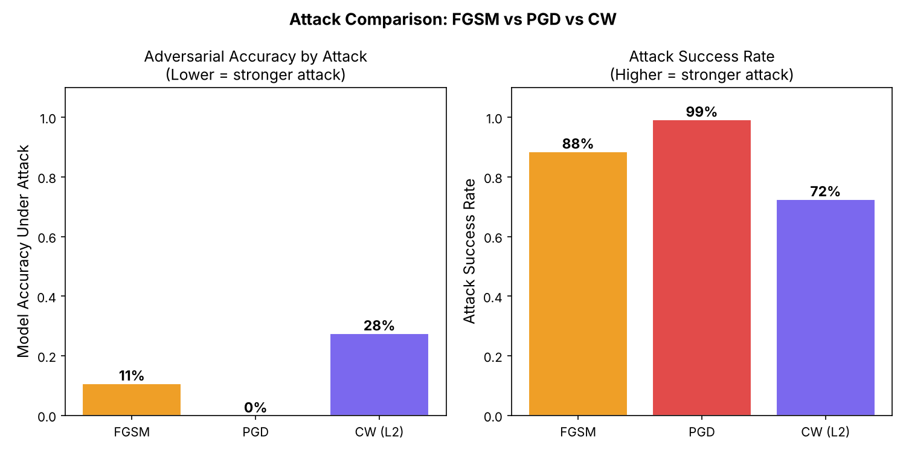
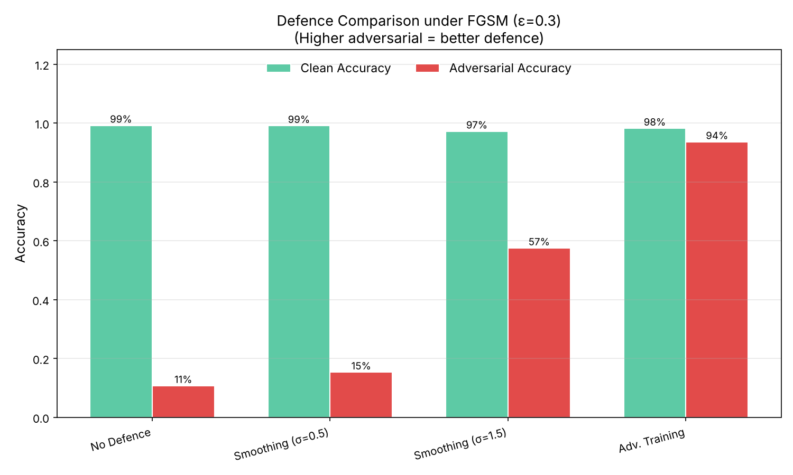

# Adversarial ML Attack & Defence System


> Implements three adversarial attacks from scratch (FGSM, PGD, CW) against a CNN trained on MNIST. At the standard ε = 0.3 budget, PGD drops accuracy from 99.2% to 0%; PGD adversarial training restores it to 85.9% while keeping 98.2% clean accuracy.

---

## What Are Adversarial Examples?

A neural network that classifies handwritten digits with 99% accuracy can be fooled by adding carefully crafted noise that is **completely invisible to the human eye**:

```
Clean image          → Model predicts the right digit ✓
+ bounded perturbation → Model predicts a wrong digit with high confidence ✗
```

Here the perturbation changes each pixel by at most ε = 0.3 on a 0–1 scale (the standard MNIST threat model). The digit stays clearly readable to a person, but the undefended model's accuracy falls from 99% to 0% under PGD. See `reports/figures/attack_gallery.png` for real examples from this model.

---

## Attacks Implemented

### 1. FGSM — Fast Gradient Sign Method
**Paper**: Goodfellow et al., "Explaining and Harnessing Adversarial Examples" (2014)

```
x_adv = x + ε · sign(∇_x L(model(x), y))
```

Single-step attack. Move input in the direction that maximally increases loss.
Fast but suboptimal — a useful baseline.

### 2. PGD — Projected Gradient Descent
**Paper**: Madry et al., "Towards Deep Learning Models Resistant to Adversarial Attacks" (2017)

```
x_0 = x + uniform_noise
x_t = Proj_{B(x,ε)}(x_{t-1} + α · sign(∇L))
```

Multi-step iterative attack. Projects back into epsilon-ball after each step.
Currently the **gold standard** first-order attack.

### 3. CW — Carlini-Wagner L2
**Paper**: Carlini & Wagner, "Evaluating the Robustness of Neural Networks" (2017)

Optimisation-based attack minimising L2 perturbation norm.
Often produces smaller, less detectable perturbations than FGSM/PGD.

---

## Results

All numbers below are produced by `make attack` and saved to `results/results.json`. Test set: first 1,000 MNIST test images (CW: first 200). ε is in [0, 1] pixel units. All attacks are white-box.

### Attacks on the undefended CNN

| Attack | Clean Acc | Adversarial Acc | Success Rate |
|--------|-----------|-----------------|--------------|
| FGSM (ε=0.3) | 99.2% | 10.7% | 88.5% |
| PGD (ε=0.3, 40 steps) | 99.2% | **0.0%** | 99.2% |
| CW (L2, c=10, 100 iters) | 100.0% | 27.5% | 72.5% |

CW is not bounded by ε. It looks for the *smallest* L2 perturbation that fools the model, so its changes are much smaller: mean L2 ≈ 1.15 in pixel units (averaged over all 200 images), vs ≈ 5.6 for FGSM/PGD.

### Defences

| Defence | Clean Acc | Acc under FGSM (ε=0.3) | Acc under PGD-40 (ε=0.3) |
|---------|-----------|------------------------|--------------------------|
| No defence | 99.2% | 10.7% | 0.0% |
| Gaussian smoothing (σ=0.5) | 99.1% | 15.3% | – |
| Gaussian smoothing (σ=1.5) | 97.2% | 57.5% | – |
| **PGD adversarial training** | **98.2%** | **93.6%** | **85.9%** |

Adversarial training: 5 epochs, PGD-7 (step 2.5·ε/7), 50/50 clean + adversarial loss, 15 min on a 2-core CPU (`make robust`). The robust model is attacked with examples generated against **itself**, so its numbers are a fair white-box test.

**Caveat on smoothing:** the smoothing numbers use FGSM examples crafted against the *undefended* model, i.e. the attacker does not know about the blur. An adaptive attacker who attacks through the smoothing would do much better, so treat these as an upper bound.

---

## Demo Screenshots

### Attack Gallery — Clean vs Adversarial Images


### Epsilon Sweep — How Attack Strength Affects Accuracy


### Attack Comparison — FGSM vs PGD vs CW


### Defence Comparison


---

## Project Structure

```
adversarial-ml-defence/
├── src/
│   ├── model.py              # CNN architecture + MNIST training
│   ├── attacks.py            # FGSM, PGD, CW attacks from scratch
│   ├── defence.py            # Adversarial training + preprocessing defences
│   ├── train_robust.py       # PGD adversarial training
│   ├── run_experiments.py    # Full experiment pipeline
│   ├── visualise.py          # All plots
│   └── demo.py               # Flask interactive demo
├── test/
│   ├── test_attacks.py       # Unit tests for attack implementations
│   └── test_defence.py       # Unit tests for defence mechanisms
├── reports/figures/          # Generated plots
├── results/results.json      # Numbers behind every table above
├── models/                   # Trained weights (clean + robust)
├── requirements.txt
└── Makefile
```

---

## Setup & Run

```bash
# 1. Clone
git clone https://github.com/aarushij01/adversarial-ml-defence.git
cd adversarial-ml-defence

# 2. Install
pip install -r requirements.txt

# 3. Train the CNN (2-3 min on CPU)
PYTHONPATH=. python src/model.py

# 4. Adversarial training (~15 min on CPU)
PYTHONPATH=. python src/train_robust.py --epochs 5

# 5. Run all attacks and defences, generate plots and results.json
PYTHONPATH=. python src/run_experiments.py

# 6. Launch interactive demo
PYTHONPATH=. python src/demo.py
# Open http://127.0.0.1:5003

# 7. Run tests
PYTHONPATH=. pytest test/ -v
```

---

## What I Learned

- **Adversarial examples transfer** (known result, not measured here) — perturbations crafted for one model often fool other models, so the threat exists even without model access
- **PGD is strictly stronger than FGSM** — with enough steps, PGD finds near-optimal perturbations within the epsilon-ball
- **Preprocessing defences are brittle** — an adaptive attacker who knows you're using smoothing can generate perturbations that survive it
- **Adversarial training is expensive but effective** — here it took robust accuracy under PGD from 0% to 85.9% for about 1 point of clean accuracy, at about 8× the gradient computations of normal training (7 attack steps + 1 update per batch)
- **Units matter** — inputs are normalised, so ε must be converted to model-input units (ε / 0.3081). An earlier version of this code applied ε = 0.3 to normalised inputs, which is really ε ≈ 0.09 in pixels and made every attack look much weaker than it is
- **The arms race is asymmetric** — defenders must be robust to ALL attacks; attackers only need to find ONE that works

## Limitations

- MNIST is a toy dataset — real adversarial ML research uses ImageNet
- Only L-infinity and L2 norm attacks — other threat models exist (L0, spatial)
- Small CNN and 5 training epochs; Madry et al. report higher PGD robustness with a larger model and longer training
- Smoothing is only evaluated against non-adaptive attacks (see caveat above)
- Results are from one training seed

---

## References

- Goodfellow et al. (2014) — Explaining and Harnessing Adversarial Examples (FGSM)
- Madry et al. (2017) — Towards Deep Learning Models Resistant to Adversarial Attacks (PGD)
- Carlini & Wagner (2017) — Evaluating the Robustness of Neural Networks (CW)
- Szegedy et al. (2013) — Intriguing Properties of Neural Networks (first adversarial examples paper)
